# User guide — Pathways viewer for *Saccharomyces cerevisiae*

日本語: [MANUAL.md](MANUAL.md)

> **Note:** The screenshots in this guide show the Japanese UI. Labels in the English UI follow the names used in this guide.

This app maps regulatory relations between budding yeast genes (phosphorylation, transcriptional regulation, binding, etc.)
so you can explore "what lies upstream and downstream of a gene" and "which paths connect two genes".
This guide walks first-time users through **map operations** and **the left tabs**.

Detailed rules (layout, how levels are determined, etc.) are in the app's "Help" buttons and the [README](../README.md).

Screenshots in sections 1, 6 (except Saved views), and 7 are from the current version. Others are from an earlier version, so selectors above the map ("Color", "Condition", etc.) and left tab names ("TFs", etc.) may differ, but the operations are the same.

---

## Contents

1. [Screen layout](#1-screen-layout)
2. [Putting genes on the map (search and focus)](#2-putting-genes-on-the-map-search-and-focus)
3. [Reading the map](#3-reading-the-map)
4. [Map operations (select, expand, edges)](#4-map-operations-select-expand-edges)
5. [Map panel buttons and settings](#5-map-panel-buttons-and-settings)
6. [Left tabs](#6-left-tabs)
   - [Genes](#6-1-genes--choose-genes-on-the-map-from-a-list)
   - [TF](#6-2-tf--add-transcription-factors-to-the-map)
   - [Paths](#6-3-paths--explore-how-genes-are-connected)
   - [Conditions](#6-4-conditions--under-which-conditions-a-relation-was-reported)
   - [Deletions](#6-5-deletions--measured-data-in-deletion-strains)
   - [Saved views](#6-6-saved-views--save-maps-you-use-often)
7. [Expression and phosphorylation by condition](#7-expression-and-phosphorylation-by-condition)
8. [Database and Sources tabs](#8-database-and-sources-tabs)
9. [Examples](#9-examples)
10. [Troubleshooting](#10-troubleshooting)

---

## 1. Screen layout

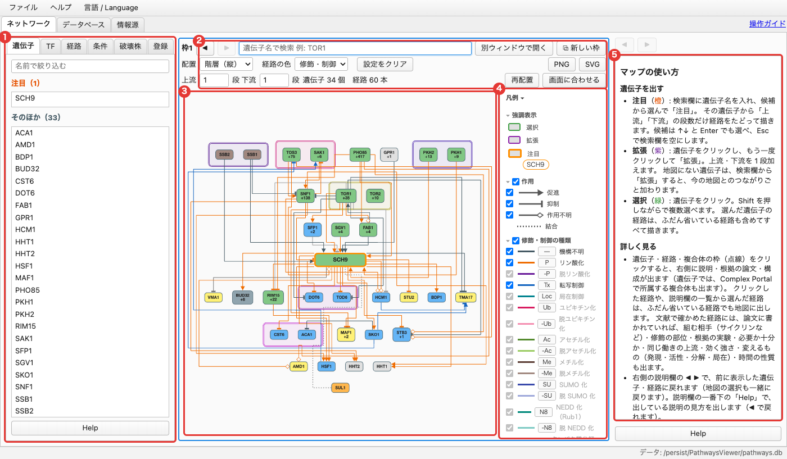

The Network tab is divided into five areas (numbers are the red circles in the image).

| No. | Area | Purpose |
|---|---|---|
| 1 | **Left tabs** (Genes, TF, Paths, Conditions, Deletions, Saved views) | Choose genes on the map from lists, add transcription factors, explore paths, highlight by condition, color by deletion strain data, etc. |
| 2 | **Search box** (above the map panel) | Find a gene and put it on the map. The two rows below hold settings such as layout, edge color, and steps |
| 3 | **Map** | Genes (boxes) and relations (edges) |
| 4 | **Legend** (right edge of the map) | Meaning of colors, edges, and symbols. Uncheck an item to hide that type from the map |
| 5 | **Details panel** (far right) | Details and supporting papers for the clicked gene, edge, or box |

At startup, the map is focused on TOR1. Use the tabs at the top of the window to switch to "Database" and "Sources" ([section 8](#8-database-and-sources-tabs)).

Every area has a **Help** button at the bottom that shows how to use it in the details panel.

---

## 2. Putting genes on the map (search and focus)

The map does not draw all genes at once; it draws **only the neighborhood of the focused gene**.

1. Type a gene name in the search box above the map panel (①) (e.g. `SCH9`). Systematic names also work.
2. Pick from the suggestions or press Enter to show the "**Expand**" / "**Focus**" pop-up (②).
3. Click "**Focus**" to redraw the map centered on that gene.

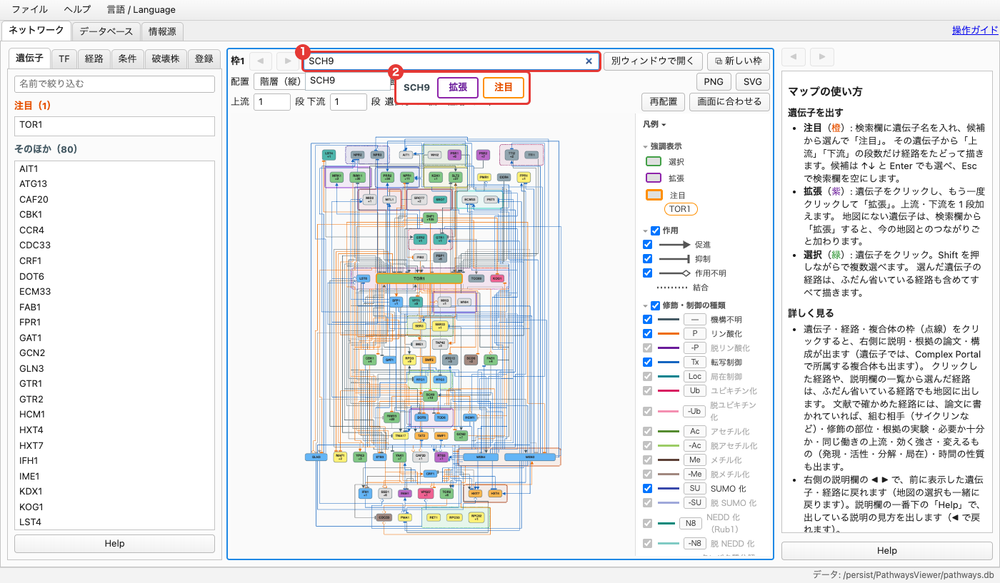

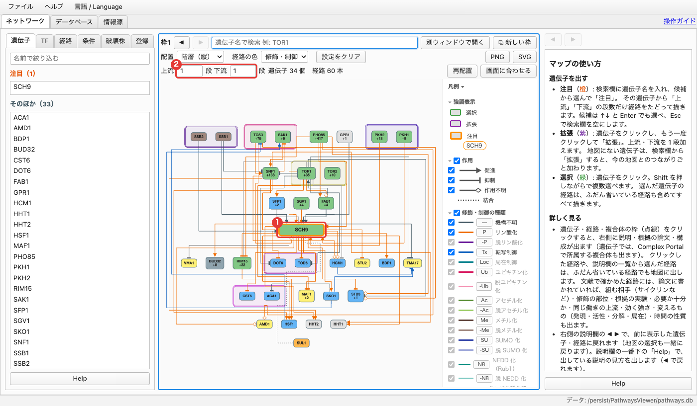

- The focused gene (①) has a **thick orange frame**. There is always exactly one focus.
- "**Upstream ○ steps, Downstream ○ steps**" below the search box (②) sets how many steps to follow from the focused gene (default 1 each). More steps add many genes at once, so start with 1–2.
- "○ genes, ○ edges" on the same row shows how many are drawn now.
- In the search box you can also pick suggestions with ↑↓ and Enter. Esc clears the box.

---

## 3. Reading the map

### Genes (boxes)

- **Box color** shows the role (kinase, phosphatase, transcriptional regulator, etc.; a rough guide inferred from the SGD functional description). See "Role" in the Legend. Only while a strain is chosen in the Deletions tab, boxes are colored by that strain's measured data ([6-5](#6-5-deletions--measured-data-in-deletion-strains)).
- **"+number"** is the number of downstream genes not yet drawn.
- **Box width** reflects the gene's number of relations (including those omitted from the map). Wide boxes are hubs.
- With the "Hierarchy (vertical)" layout, **more upstream genes are placed in higher steps**.

### Edges (relations)

- **The mark at the end of an edge** shows the effect: triangle = activation, T-bar = inhibition, open diamond = unknown effect, dotted line = undirected binding.
- **Edge color** shows the type of modification/regulation (orange = phosphorylation, purple = dephosphorylation, blue = transcriptional regulation, etc.). Switching the color to "Effect" uses red = activation, blue = inhibition, gray = unknown effect ([section 5](#5-map-panel-buttons-and-settings)).
- Relations with an unknown effect are treated as possibly either activation or inhibition.

### Boxes around genes

Genes on the map may be enclosed in three kinds of boxes.

| Box | Meaning |
|---|---|
| **Dotted box** | Complex (Complex Portal). Drawn when two or more members are on the map (e.g. TOR1, TOR2) |
| **Double-line box** | Paralogs (pairs from whole-genome duplication etc. whose roles may overlap, e.g. SSB1/SSB2, PKH1/PKH2). If one is on the map, the other is added next to it |
| **Large solid box** (bottom of the map) | Downstream bundle, such as "Downstream of ○○: phosphorylation 286". Targets of genes with more than 50 downstream genes (PHO85, CDC28, TPK1, etc.) are placed here instead of drawn as edges |

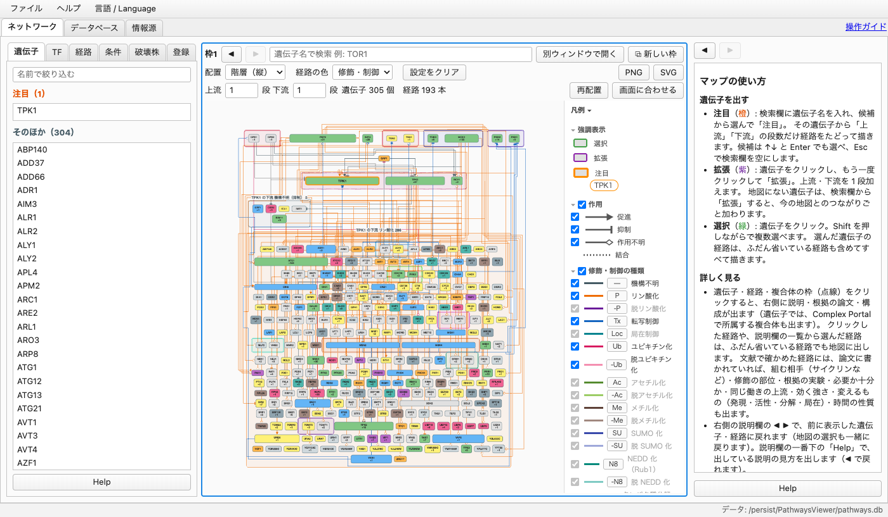

- Box names appear only when you click the box or select a gene inside it (names of downstream bundles are always shown).
- Edges between genes in a complex and edges into a downstream bundle are normally hidden. **Click the box to show them** (click again to hide).
- Relations where the paper names the partner only as a complex (TORC1, PKA, etc.) are drawn as a single edge from the box.

---

## 4. Map operations (select, expand, edges)

### Clicking a gene (select, green)

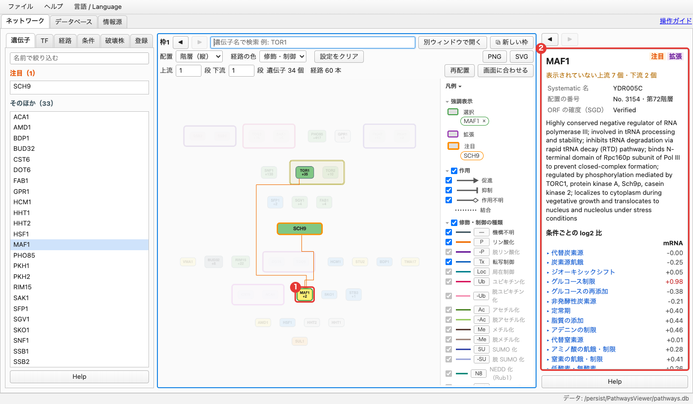

- Clicking a gene once **selects** it (green) and shows its details in the details panel on the right.
- Only genes and edges connected to the selected gene stay dark; others fade. All edges of the selected gene are drawn, including normally omitted ones.
- **Hold Shift** while clicking to select several.
- **Click the background** to clear selection and highlighting.
- You can also select from the list in the Genes tab on the left ([6-1](#6-1-genes--choose-genes-on-the-map-from-a-list)).

The details panel shows the systematic name, SGD functional description, expression and phosphorylation changes by condition (log2 ratio), upstream and downstream lists, and more. "Help" at the bottom of the details panel explains each item.

### Clicking again (expand, focus)

Click a selected gene again to show "Expand" / "Focus" (①) below it.

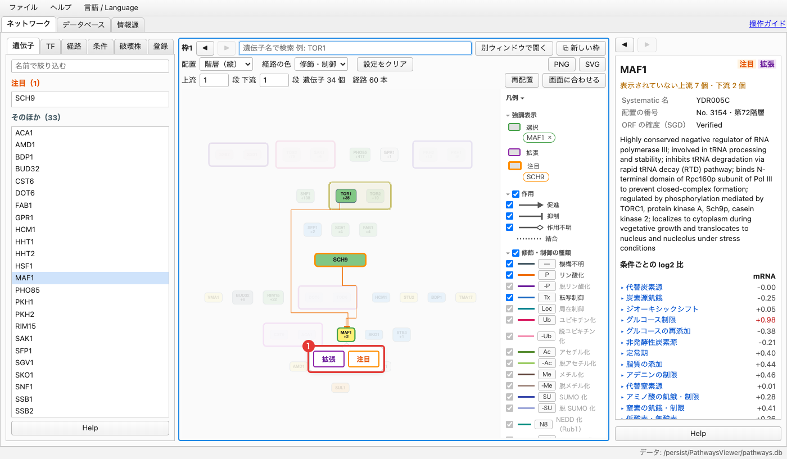

- **Focus** (orange): redraw the map centered on that gene.
- **Expand** (purple): keep the current map and add one step of that gene's direct upstream and downstream genes.

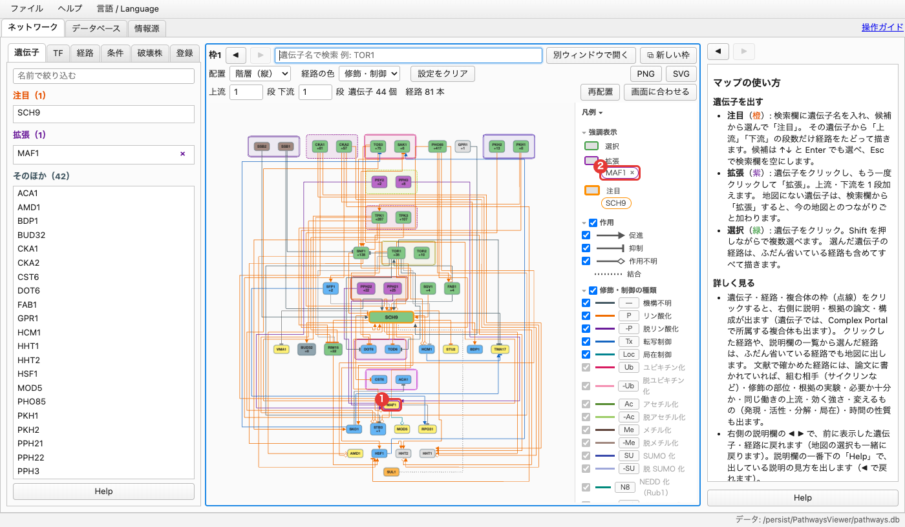

- Expanded genes have a purple frame and are listed under "Highlighted" in the Legend (②). The × next to a name removes all genes added by that expansion.
- For a gene not on the map, choosing "Expand" from the search box adds it together with its connections to the current map (paths within 3 steps).

### Clicking an edge

Click an edge to show the details of that relation in the details panel.

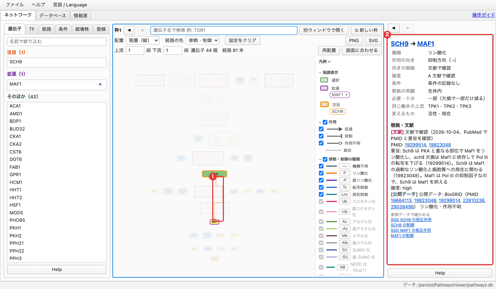

- **Type** (phosphorylation, etc.), **Effect** (activation, inhibition), **Basis for effect**, **Confidence** (A literature-verified to D inference only)
- **Condition** (conditions under which the relation was reported)
- **Evidence and references**: one line per source. Click a PMID to open PubMed.
- For literature-verified relations, the modified site, supporting experiment (in vivo, in vitro, etc.), redundant upstream regulators, and more are also shown.

### Back and forward

- **◀ ▶** at the top left of the map panel go back and forward through maps (focus, expand, steps, TFs, and the Legend and Conditions tab checkboxes are restored too).
- **◀ ▶** above the details panel go back to details shown earlier.

### Moving around the map

- Drag the background to pan; use the wheel (or pinch) to zoom.
- Genes cannot be dragged (the layout is automatic).
- When zoomed out, downstream branch tips are omitted automatically for readability (toggle under "Display" in the Legend).

---

## 5. Map panel buttons and settings

The three rows above the map panel contain these buttons and selectors.

**Row 1**

| Button | Function |
|---|---|
| ◀ ▶ | Go back / forward through maps |
| Search box | Find a gene to focus on or expand ([section 2](#2-putting-genes-on-the-map-search-and-focus)) |
| Open in new window | Show this map panel in a separate window |
| ⧉ New panel | Add a map panel (up to 4). It opens focused on the genes selected in green |

**Row 2** (settings shared by all map panels)

| Selector | Options |
|---|---|
| Layout | Hierarchy (vertical), Hierarchy (horizontal), Concentric, Grid |
| Edges | Edge color: Modification/regulation (colored by type) or Effect (red = activation, blue = inhibition) |
| Reset settings | Return TFs, paths, conditions, layout, gene colors, edges, and Legend to their defaults (focus, expand, and steps stay) |
| PNG / SVG | Save the whole map of this panel as an image (including parts not visible on screen) |

**Row 3**

| Button | Function |
|---|---|
| Upstream / downstream steps | How many steps to follow from the focused gene |
| Re-layout | Redraw the map from the current focus, expand, and steps |
| Fit to view | Fit the whole map in view (a green selection and its edges are kept) |

Gene colors are changed from the left tabs, not here (choosing a strain in the Deletions tab colors genes by its measured data; clearing the choice returns to role colors).

### Adding map panels

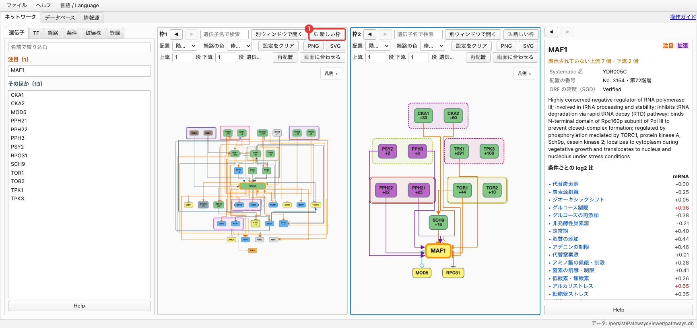

"⧉ New panel" lets you place up to four map panels, each focused on a different gene. **The blue frame marks the active map panel**, and the left tabs act on it.

### Hiding with the Legend

Uncheck a row in the Legend to hide that type from the map (shared by all map panels).

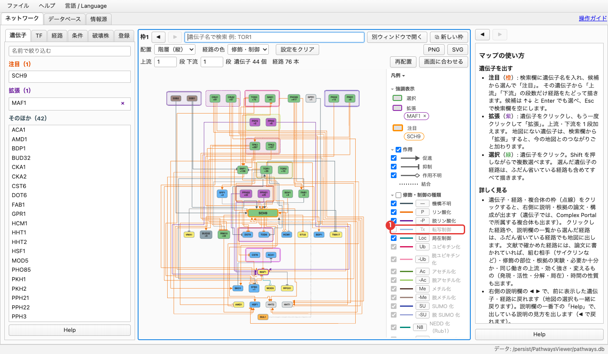

- **Effect**: activation, inhibition, and unknown-effect edges
- **Modification/regulation**: phosphorylation, transcriptional regulation, binding, and other edges
- **Role**: genes with that role
- The checkbox left of a heading toggles all items in the section.
- Hiding does not compact the layout. Click "Re-layout" to rearrange using only visible items.

---

## 6. Left tabs

All left tabs act on the **active map panel** (blue frame).

### 6-1. Genes — choose genes on the map from a list

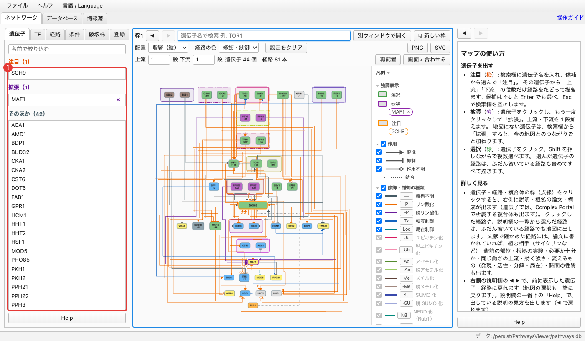

Genes on the current map are listed under the headings "**Focus**" (orange), "**Expand**" (purple), and "**Others**", each sorted by name (counts in parentheses). Type a name in the box at the top to filter.

- Click a gene to select it in green on the map and show its details on the right. Genes selected in green on the map are also selected in the list.
- **Click a gene selected in green again** to move to and zoom in on that gene on the map (same as clicking its name in the Legend).
- Hold ⌘ (Ctrl on Windows) to select one at a time, or Shift to select a range.

### 6-2. TF — add transcription factors to the map

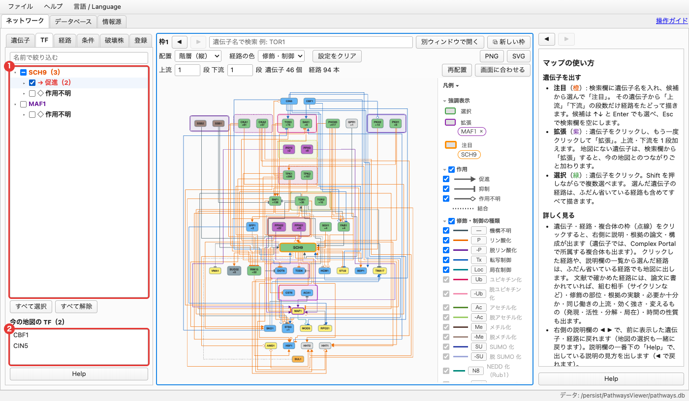

A list of the **transcription factors that regulate transcription** of the focused and expanded genes. Transcriptional regulation is not used for the vertical order of the map, so transcription factors are normally not shown. Only those checked here are placed in the **top step** of the map.

- Type a name in "**Filter by name**" at the top to keep transcription factors whose names contain it (if a gene's name contains it, all that gene's transcription factors are kept).
- The list is nested as gene → effect (→ activation, ⊣ inhibition, ◇ unknown effect) → transcription factor (the same layout as the Conditions tab). The gene title color distinguishes focus (orange) from expand (purple). ▸ opens and closes; numbers in ( ) are counts.
- Checking a gene or effect toggles all transcription factors under it. "**Select all**" / "**Clear all**" below the list apply to every transcription factor in it.
- Transcription factors are sorted by name. **Gray** ones are already on the map through other relations and are listed last in their group.
- ⇄ marks transcription factors listed under several genes (their checkboxes are linked).
- Click a transcription factor's name to show its details on the right.
- "**TFs on current map**" lists the transcription factors now on the map (by name). Click one to show its details on the right.

### 6-3. Paths — explore how genes are connected

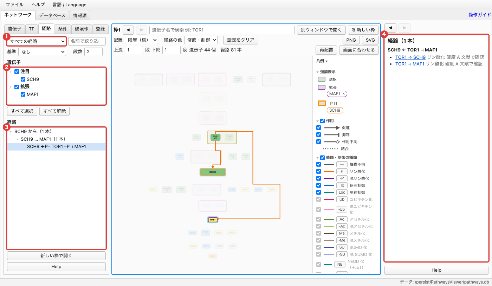

Lists **the paths that connect** the genes you choose.

**1. Choose a path mode**

- Choose which paths to show in the selector at the top left.

| Path mode | Shows |
|---|---|
| None | No paths (the normal map) |
| All paths | Paths linking the checked genes (regardless of arrow direction; includes paths via a common target, like A → X ← B) |
| Directed paths | Paths from one checked gene to another, following the arrows |
| Common regulators | Common regulators upstream of all checked genes, and paths from them |
| Common targets | Common targets downstream of all checked genes, and paths to them |
| Paths acting to / from the anchor gene | Paths to (from) the anchor gene following the arrows (choose an anchor) |

- Typing in "**Filter by name**" at the top right filters both the gene list and the path list (paths through genes with that name).

**2. Anchor and steps**

- **Anchor**: choose one of the checked genes to keep only paths that end at that gene.
- **Steps** (1–3): show only paths of **exactly** that many steps. 1 means direct relations. A complex counts as one.

**3. Choose genes**

- The "Genes" list shows the focused and expanded genes, grouped (focus, expand) and sorted by name. Check the ones to examine (checking a group toggles them together; "Select all" / "Clear all" also work).
- If the list is empty, focus on or expand genes on the map to add them.

**4. Viewing paths**

- The "Paths" list has three levels: "from SCH9" → "SCH9 … MAF1" (sorted by destination name) → each path. The number at each level is the number of paths inside.
  Symbols: → activation, ⊣ inhibition, ◇ unknown effect, ← ⊢ are arrows pointing right to left, and P, Tx, etc. are relation types. Long paths are shortened; hover to see the whole path.
- Common regulators or targets, if any, are listed below with their count and names (the first 30 if there are many; all are under "from X" in the list).
- Selecting a path in the list draws and highlights it on the map (selecting an upper level draws all paths inside). Intermediate genes not on the map are added temporarily. Click a selected path again to deselect it.
- The details panel on the right lists, for each selected path, the relation at each step (edge, type, confidence). Click an edge name to see that relation's details (supporting papers, etc.). Deselecting returns to the Paths tab help.
- Clicking a gene on the map moves paths through that gene to the top and grays out and moves down pairs that do not pass through it. Click the background to undo.
- If the list is cut off because there are too many paths, reduce the steps or check fewer genes.
- "**Open in new panel**" shows only the genes of the drawn paths in a new map panel.
- Set the path mode to "None" to return to the normal map.
- Paths also follow transcriptional regulation. Relation types hidden in the Legend are not followed.

### 6-4. Conditions — under which conditions a relation was reported

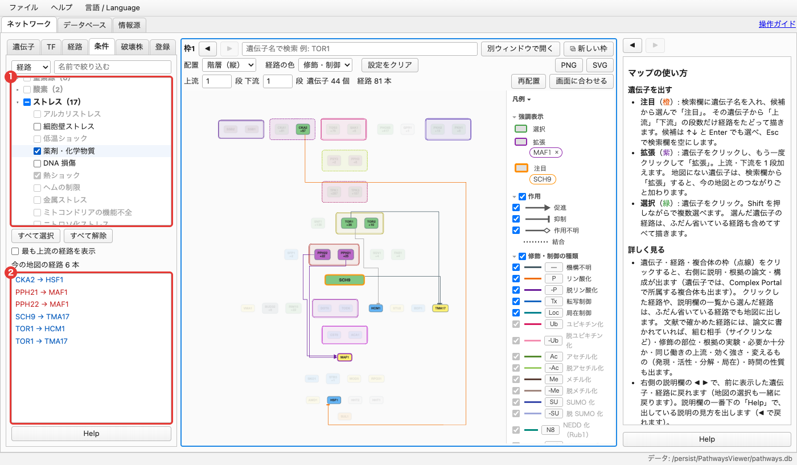

The selector at the top left switches between "**Paths**" and "**Genes**". Both share the same layout: the condition list at the top (grouped and collapsible; gray conditions also have faded checkboxes), viewing options such as "Select all" / "Clear all" in the middle, and items on the current map at the bottom. Type a name in the box on the right to filter conditions. For "Genes", see [section 7](#7-expression-and-phosphorylation-by-condition). The rest describes "Paths".

This filters the map by **the conditions under which relations (edges) were reported** (stress, nutrients, cell-cycle phase, etc.). Conditions follow the YEASTRACT+ environmental conditions, with cell-cycle phases (G1, S, G2, M, etc.) added.

- Only edges with the checked conditions and the genes at both ends are highlighted. Other edges are removed and other genes are faded. With everything checked, you see the normal map.
- Open groups (stress, carbon source, cell cycle, etc.) with ▸; checking a group toggles its conditions.
- "**Select all**" / "**Clear all**" below the list toggle all conditions. A common approach is to click "Clear all" and then check only the conditions you want.
- **Conditions with no edges on the current map are gray.** Choosing a black condition changes the map.
- "**Show most upstream paths**": highlights only the edges with the checked conditions that start a path, and the genes at both ends.
- "No condition recorded" means relations whose conditions are not yet known.
- The bottom box lists edges on the current map that match the checked conditions, by name. Click one to show its details on the right.
- A condition means "reported under that condition"; the relation does not necessarily act only then.

### 6-5. Deletions — measured data in deletion strains

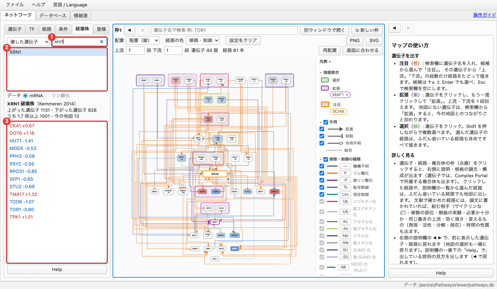

See on the map **how mRNA and phosphorylation of other genes actually changed** (measured ratios vs. wild type) in strains with one gene deleted.

- **Browse by** (selector at the top left):
  - **Deleted gene**: deletion strains sorted by name; type a name in the box on the right to keep strains containing it. Clicking a strain colors the map by its data and lists, in the box below, **genes on the current map** that changed in it, by name (the heading shows the total count and the count on the current map).
  - **Changed gene**: genes on the current map sorted by name (filter with the box on the right). Click a gene to show its details on the right and list, in the box below, the deletion strains that changed it, by name. Clicking a strain colors the map by that strain and shows the deleted gene's details on the right. This lets you find candidate upstream genes from measured data.
- In the strain list, strains in which genes on the current map changed are black; strains with no change are gray.
- **Data**: switch between mRNA (Deleteome, Kemmeren et al. 2014, 1,481 strains) and phosphorylation (Bodenmiller et al. 2010, 113 kinase and phosphatase strains).
- Map colors: red = increased, blue = decreased, black = deleted gene. Role colors return when the strain is deselected: by clicking the colored strain again, when a filter removes it from the list, or by switching to "Changed gene".
- Effects of a deletion include indirect ones (X → Z → Y). Deleteome was measured in rich medium, so genes that act only under stress may show no change when deleted.

### 6-6. Saved views — save maps you use often

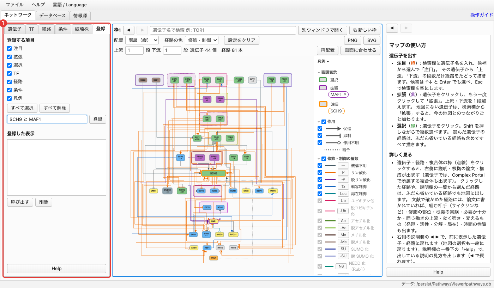

Save map states you use often under a name and load them later.

1. Under "Items to save", check the items to keep (Focus, Expand, Select, TF, Paths, Conditions, Legend; "Select all" / "Clear all" toggle them together).
2. Enter a name and click "**Save**".
3. Pick a view in the "Saved views" list (sorted by name) and click "**Load**" (or double-click) to apply only the saved items to the active map panel. Other items stay as they are (a view without paths keeps the current paths).

- Selecting a view shows its date and contents in the details panel on the right. Click the selected view again, or click outside the list, to deselect.
- Saving with an existing name overwrites it.
- Saved views are kept only on this computer.

---

## 7. Expression and phosphorylation by condition

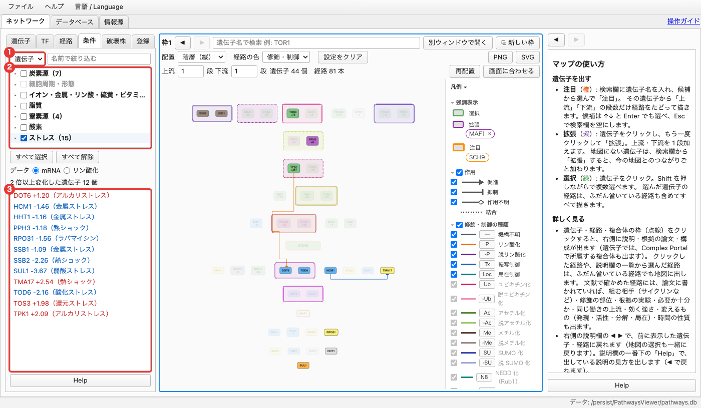

Switch the top-left selector of the **Conditions** tab to "**Genes**" and choose mRNA or phosphorylation under "Data". Only **genes that changed 2-fold or more** in any checked condition (any number; group checkboxes and "Select all" / "Clear all" toggle them together) are highlighted; others fade. With everything checked, you see the normal map. Map colors are not changed.

- The box below lists the highlighted genes on the current map by name. The value is the largest change among the checked conditions, with that condition in parentheses (red = up, blue = down). Click one to show its details on the right.
- Values are log2 ratios vs. the control (before or without treatment) (+1 = 2-fold, −1 = half).
- **Expression (mRNA)**: SGD expression data (93 measurements, including Gasch 2000 and Causton 2001).
- **Phosphorylation**: Leutert et al. 2023 (changes after 5 min exposure to about 100 conditions). This is whether the gene's protein was phosphorylated, not the kinase's own activity.
- Clicking a gene lists values for all conditions under "log2 ratio by condition" in the details panel. Click a condition name to expand the values per measurement and the source papers.
- Many genes (kinases such as TOR1 and SCH9) change their activity by phosphorylation or localization without mRNA changes, so look at expression and phosphorylation separately.

---

## 8. Database and Sources tabs

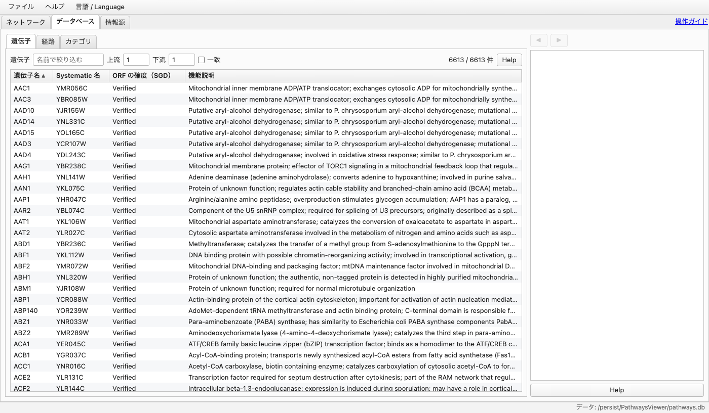

- **Database** tab: lists of genes, regulatory relations, and categories (complexes, paralogs). Filter by name, upstream/downstream, and condition (toggle conditions with "Clear all" / "Select all"), and export with "Export visible table to CSV…" (gene and relation tables only; disabled on the Categories tab). Selecting a row shows its details on the right (same content as the Network details panel; empty at first, with help under Help at the top right of the table). View only.
- **Sources** tab: data sources (SGD, BioGRID, YEASTRACT+, etc.), the papers used in the literature review (filter by title or author), and their terms of use.

The server version of the data is authoritative; at every start, a newer version is installed automatically if available (you can also check with "File > Check for latest data").

---

## 9. Examples

### Example 1: Look upstream and downstream of SCH9

1. Type `SCH9` in the search box and click "Focus".
2. Look at the upstream genes (TORC1, PKH1/2, etc.) and downstream genes (MAF1, RIM15, DOT6/TOD6, etc.) on the map.
3. Click an edge of interest (e.g. SCH9 → MAF1) and check the supporting papers in the details panel.

### Example 2: Find how SCH9 and MAF1 are connected

1. Focus on SCH9, click MAF1 on the map twice, and choose "Expand".
2. In the Paths tab on the left, check SCH9 and MAF1.
3. Set the steps to 2 and choose the path mode "All paths".
4. Select a path in the list (e.g. SCH9 ← TOR1 ⊣ MAF1) to draw it on the map.

### Example 3: Show only relations active under stress

1. In the Conditions tab on the left (top-left set to "Paths"), click "Clear all".
2. Open "Stress" with ▸ and check a condition shown in black (e.g. Heat shock).
3. Click edges in the box below or on the map, and check "Condition" and the evidence in the details panel.

### Example 4: Find genes whose expression changes strongly under stress

1. Switch the top-left selector of the Conditions tab to "Genes" and set "Data" to mRNA.
2. Click "Clear all", then check the "Stress" group.
3. Look at the highlighted genes and the values in the box below (which condition, how many fold). Click a gene to see values for all conditions in the details panel.

### Example 5: See what changes on the map when a gene is deleted

1. In the Deletions tab on the left, type the deleted gene's name (e.g. `XRN1`) and click the strain.
2. The map is colored by the measured changes (red, blue), and genes on the current map that changed are listed below. Click a gene to see its details.
3. When done, click the colored strain again (it is deselected and role colors return).

---

## 10. Troubleshooting

| Problem | What to do |
|---|---|
| The map is too crowded to read | Reduce the steps to 1, narrow relation types in the Legend, click "Re-layout", or use "Fit to view" to see the whole map |
| A confirmation appeared before edges were drawn | It appears when many edges are about to be drawn. "Cancel" returns to the previous view |
| I want to go back to the original state | Go back with ◀. To reset only settings, use "Reset settings" |
| The map stays faded | Click the background. In the Conditions tab, click "Select all" (for both "Paths" and "Genes"); in the Paths tab, set the path mode to "None" |
| Gene colors do not return to role colors | In the Deletions tab, click the colored strain again |
| The gene I'm looking for does not appear | Search by systematic name too (e.g. YHR205W). Search by name in the Database tab |
| Coloring is mostly gray | Those genes have no data for that strain. Try another strain in the Deletions tab |
| No genes stand out in the Conditions tab (Genes) | No gene on the current map changed 2-fold or more in the checked conditions. Add conditions or change "Data" |
| I want to check how to use something | The "Help" button at the bottom of each area, or "Help > How to use" in the menu |
